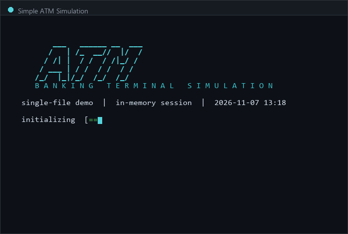
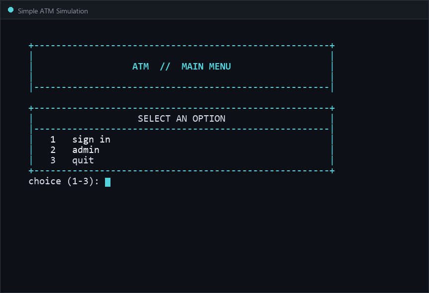
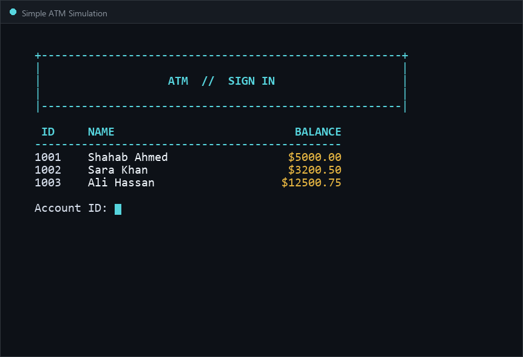
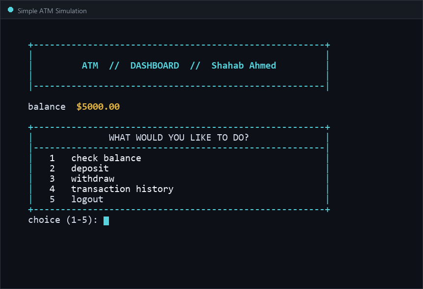
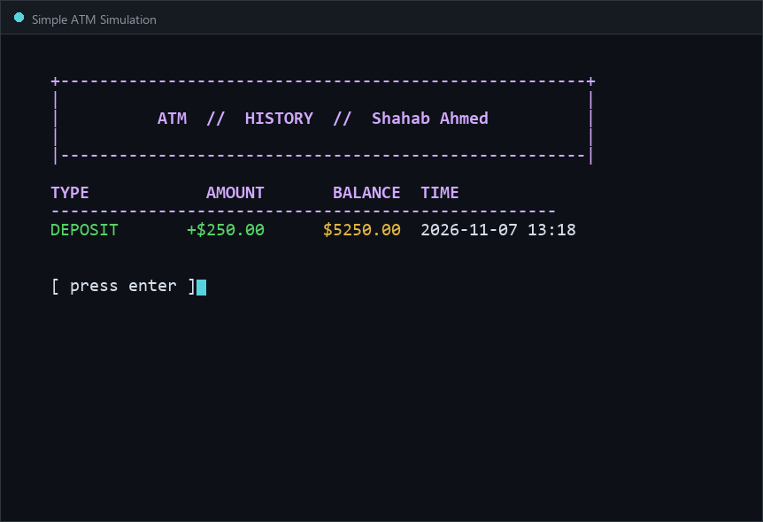

# Simple ATM Simulation

**A single-file C++17 console ATM simulator** with PIN authentication, multi-account banking, deposits, withdrawals, transaction history, and an ANSI-colored terminal UI.

<p align="center">
  
</p>

<p align="center">
  <a href="https://github.com/ShahabAhmed01/Simple-ATM-Simulation/actions/workflows/ci.yml"></a>
  
  
</p>

> **Demo project:** the accounts, balances, and PINs are stored in memory. This is not connected to a bank, does not persist data, and is not intended for real financial use.

## What it does

The program models a small ATM in one C++ file. Sign in with an account ID and a 4-digit PIN, then check your balance, deposit, withdraw, or review your transaction history. An admin mode can create and delete accounts. Accounts and transactions reset when the program exits.

## Quick start

### Requirements

- A C++17 compiler (`g++` or `clang++`)
- A terminal with ANSI color support — on Windows, use Windows Terminal
- Python 3.8+ only if you want to run the test suite

There are no third-party runtime dependencies.

### Build and run

**Linux / macOS:**

```bash
g++ -std=c++17 -O2 -o atm "Atm Simulation.cpp"
./atm
```

**Windows PowerShell (MinGW-w64):**

```powershell
g++ -std=c++17 -O2 -o atm.exe "Atm Simulation.cpp"
.\atm.exe
```

If `g++` is not on your `PATH`, install a C++17 toolchain such as MinGW-w64 or MSYS2 and open a new terminal.

### Demo credentials

| Account | ID | PIN |
|---|---|---|
| Shahab Ahmed | `1001` | `1234` |
| Sara Khan | `1002` | `4321` |
| Ali Hassan | `1003` | `0000` |
| Admin | — | `9999` |

New accounts created through the admin panel receive IDs starting at `1004`.

## Features

- **PIN authentication** with three attempts per sign-in
- **Multiple customer accounts** with independent balances and histories
- **Deposit, withdraw, and balance inquiry**
- **Per-account transaction history** — shows the 15 most recent transactions
- **Admin panel** for creating and deleting accounts
- **ANSI color UI** with a startup banner, loading bar, and boxed layouts
- **`--fast` mode** to skip animation delays for tests and automation
- **No runtime dependencies** — standard library only

## Screenshots

| Main menu | Sign in |
|---|---|
|  |  |
| **Dashboard** | **Transaction history** |
|  |  |

Screenshots are rendered from a real recorded session. See [`demo-assets/README.md`](demo-assets/README.md) for the capture and rendering scripts.

## Example session

Excerpt from a real session, with ANSI colors removed:

```text
   choice (1-5): 2

   +------------------------------------------------------+
   |                                                      |
   |          ATM  //  DEPOSIT  //  Shahab Ahmed          |
   |                                                      |
   |------------------------------------------------------|

   Current balance: $5000.00

   Amount to deposit: $250

   +------------------------------------------------------+
   |                 + $250.00  deposited                 |
   |                New balance: $5250.00                 |
   +------------------------------------------------------+
```

## How it works

- `Account` stores the account ID, name, PIN, balance, and transaction history.
- `Bank` owns the accounts and assigns account IDs.
- `ATM` handles the terminal UI, authentication, menus, and banking flows.
- Everything is held in memory; there is no database, file, or network layer.
- Money is stored as `double` for simplicity. This is a demo choice, not a
  recommendation for financial software.

The application is a single translation unit: [`Atm Simulation.cpp`](Atm%20Simulation.cpp).

## Testing

The integration tests compile the app into a temporary directory and drive it
with scripted input. They use `--fast` so animation delays do not slow CI.

```bash
python -m unittest discover -s tests -v
```

Set `CXX` if your compiler command is not `g++`:

```bash
CXX=clang++ python -m unittest discover -s tests -v
```

The tests cover sign-in, balance inquiry, deposits, withdrawals, insufficient
funds, the three-attempt sign-in limit, admin account creation, invalid input,
and EOF handling. CI builds and tests on Ubuntu, Windows (MinGW), and macOS
(Clang).

## Limitations

This is an educational simulation, not a banking product.

- **No persistence** — accounts and transactions are lost when the program exits.
- **PINs are echoed** as you type; there is no masked input.
- **Money uses `double`**, not fixed-point decimal arithmetic.
- **The admin PIN is hardcoded** and displayed on the admin screen.
- **No encryption, database, network, or audit log** exists.
- **Transaction history displays only the 15 most recent entries**; older entries remain in memory but are not shown.
- **`$` and English-only UI** are hardcoded.
- **ANSI colors** require a compatible terminal; Windows Terminal is recommended.

Do not use real credentials or personal data with this project.

## Project structure

```text
Simple-ATM-Simulation/
├── Atm Simulation.cpp          # Application source
├── README.md
├── CONTRIBUTING.md
├── SECURITY.md
├── CHANGELOG.md
├── tests/
│   └── test_atm.py             # Scripted integration tests
├── demo-assets/
│   ├── demo.gif
│   ├── screenshots/
│   └── tools/                  # Reproducible capture/render scripts
└── .github/
    ├── workflows/ci.yml
    ├── ISSUE_TEMPLATE/
    └── PULL_REQUEST_TEMPLATE.md
```

## Contributing

Contributions are welcome. Start with [`CONTRIBUTING.md`](CONTRIBUTING.md) for
setup, testing, and pull-request expectations. Small fixes and documentation
improvements do not need a prior issue.

## Security

This project is a simulation and has no real credentials or customer data. If
you find a security issue, follow [`SECURITY.md`](SECURITY.md) and report it
privately rather than opening a public issue.

## License

No open-source license has been added to this repository yet. Copyright © 2026
Shahab Ahmed. The source is publicly visible for viewing and portfolio review,
but that does not by itself grant permission to copy, modify, or redistribute it.

If you would like to reuse the code, please open an issue to discuss licensing
first.

## Author

**Shahab Ahmed** — [GitHub](https://github.com/ShahabAhmed01) · [LinkedIn](https://www.linkedin.com/in/shahabahmed01/) · [Portfolio](https://shahabahmed01.github.io)
